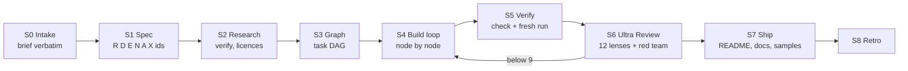

<div align="center">

# 🔥 Grillman

**Grill the brief. Build the proof. Ship the 10/10.**

One slash command turns any project brief or technical assignment into a spec-traced, evidence-backed, self-reviewed submission. Works in any agent that reads markdown instructions (Claude Code, Codex, Cursor, Gemini CLI and similar) and, as a single pasted prompt, in any chat AI. Built to spend as few tokens as possible.

`/grillman` + your brief (and attached files) = a finished, reviewed deliverable pack.

</div>

---

## Why Grillman

Most AI "assignment solutions" fail the same way: they skim the brief, pick a generic stack, claim results they never measured, and stop when the code first runs. Grillman is a protocol that blocks each of those failures.

| Failure of generic AI solutions | Grillman's answer |
|---|---|
| Skips or reinterprets requirements | **Brief is law**: stored verbatim, every sentence becomes an ID, a checker proves coverage |
| "Should work" claims | **Evidence gate**: a task is DONE only with a command output, metric or file path |
| Invented numbers and placeholders | **Real or nothing**: honest fallbacks, labelled limits, claims audit |
| One-shot, no self-critique | **Ultra Review**: 12 lenses, red-team grader simulation, fix loop until 9+/10 |
| Burns tokens re-reading chat | **Files are memory**: SPEC, GRAPH, CONTEXT on disk, references loaded only when needed |
| Looks like every other submission | **Anti-generic rules**: trade-off tables, rejected alternatives, failure galleries |

## The engine: Prompt + Loop + Context + Graph + Software Factory



- **Prompt:** 8 Laws that outrank everything, role + output contract, anti-generic rules.
- **Loop:** per-node build, run, diagnose, fix (max 3 attempts), plus a global review-and-fix loop.
- **Context:** `.grillman/` holds BRIEF, SPEC, GRAPH, CONTEXT, REVIEW. The agent re-reads files, not history.
- **Graph:** a real task DAG with acceptance checks, walking skeleton first, riskiest node early, critical path marked.
- **Software factory:** stage gates with distinct hats (Analyst, Researcher, Architect, Engineer, QA, Red-team, Writer).

## Install

**Any agent, one script** (copies the skill and the `/grillman` command):

```bash
git clone https://github.com/itzmoksh01/Grillman && cd Grillman
./install.sh claude            # or: codex | cursor | gemini | agents | all
./install.sh claude --project  # install into the current project instead of ~
```

**Windows (PowerShell):** `.\install.ps1 -Target claude` (not yet tested on Windows, please report issues). Git Bash or WSL can use `install.sh`. On Windows the skill calls `py` instead of `python3`.

**Skills CLI:** `npx skills add itzmoksh01/Grillman` should work for agents supported by that CLI (not verified by this repo).

**Claude Code plugin layout** is included (`.claude-plugin/plugin.json`, `skills/`, `commands/`).

**No install, any chat AI** (ChatGPT, Claude.ai, Gemini, DeepSeek, local models): paste [`GRILLMAN_MASTER_PROMPT.md`](GRILLMAN_MASTER_PROMPT.md), replace the `<brief>` block with your brief, attach files if the platform allows it.

Tool folder conventions differ between versions. If a path is wrong for your tool, copy `skills/grillman/` into that tool's skills folder.

## Use

```
/grillman <paste your brief here>
```

or attach the brief (PDF, doc, images, sample data) and run `/grillman` with nothing else. Grillman then works on its own:

0. If `.grillman/` already exists it resumes from `CONTEXT.md` and `grillman.py next` instead of starting over.
1. Stores the brief verbatim and opens every attachment.
2. Builds `SPEC.md`, researches only what is uncertain, builds `GRAPH.md`.
3. Builds and verifies node by node, with evidence.
4. Reviews itself until every lens scores 9 or more.
5. Ships the exact deliverables and a 25-line Final Report with your next steps.

Make a ready-to-paste prompt for one assignment (brief baked in verbatim):

```bash
scripts/make_prompt.sh my_brief.md [leads.md] > PASTE_ME.md
```

See [`examples/newspaper-ad-detection/`](examples/newspaper-ad-detection/) for a real brief with leads and a generated prompt.

## What is inside

```
Grillman/
├── skills/grillman/
│   ├── SKILL.md                 the protocol (8 Laws, pipeline, safety rails, modes)
│   ├── references/              loaded on demand (intake, research, graph, loop,
│   │                            review, delivery, domain playbooks, anti-generic)
│   ├── templates/               BRIEF, SPEC, GRAPH, CONTEXT, REVIEW
│   ├── examples/toy/            small worked example that passes the gate
│   └── scripts/grillman.py      init | check | next | status (stdlib only)
├── commands/                    /grillman for Claude Code, Codex, Cursor, Gemini
├── GRILLMAN_MASTER_PROMPT.md    self-contained prompt for any AI platform
├── scripts/make_prompt.sh       brief -> ready-to-paste prompt
├── examples/                    real brief + leads + generated prompt
├── tests/  evals/  docs/        17 unit tests, behavioural eval prompts, review report, CI template
├── install.sh  install.ps1  AGENTS.md  .claude-plugin/plugin.json  LICENSE
```

## The checker

`python3 skills/grillman/scripts/grillman.py check` fails unless: every R/D/E/N id is covered by a DONE node with evidence, every file path named in Evidence exists, no node is DONE before its dependencies, no node is left open, the DAG has no cycles, and every review lens scores 9 or more. `next` lists the nodes ready to build, so a new session resumes without re-reading everything. It is deliberately dumb and deterministic: a script that checks is cheaper and harder to fool than prose that explains.

## Token efficiency

Measured sizes (`wc -w`): SKILL.md about 1,200 words, each reference 190 to 440 words and loaded only at its stage, the standalone master prompt about 1,700 words. Beyond that: file-based memory, one-line status updates, no echoing of written files, grep or range reads, a script for the gates, a 25-line final report. Per-run token usage has not been benchmarked yet.

## Honest limits

Grillman improves process and rigour. It does not add capability the underlying model lacks, cannot supply missing data, GPUs or credentials, and cannot guarantee a grade. When something is missing it says so and labels the fallback.

## Responsible use

Grillman is a process, not a license to bypass rules. If an assignment, course or employer restricts AI assistance, follow that rule. For hiring or academic briefs Grillman also produces `docs/VIVA_QA.md` so you can explain every decision in an interview. Submit only work you understand.

## Verification status

Tested: the checker (17 unit tests, including fake evidence, dependency order, cycles, decimal scores, resume), prompt generation, shell syntax, the installer on Linux, secret scanning, the toy example. Not yet verified: behaviour inside each agent (use `evals/evals.json` to test), the Windows installer, the `npx skills` route, CI (template in `docs/ci.yml`), measured token savings. See [`docs/REVIEW_v1.md`](docs/REVIEW_v1.md).

## Contributing

PRs welcome, see [CONTRIBUTING.md](CONTRIBUTING.md). Keep every addition load-bearing and short.

## License

MIT, see [LICENSE](LICENSE).
